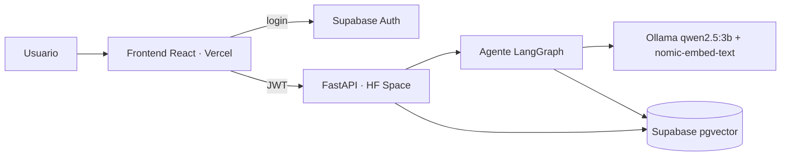

# Hextech Archive

Aplicación web en la que un usuario autenticado conversa con un agente sobre el **lore de Runeterra y los campeones de League of Legends**. El agente (LangChain + LangGraph, modelo local con Ollama) responde **solo** con información recuperada de una base vectorial (pgvector) y cita sus fuentes; si no hay contexto suficiente, rechaza explícitamente. El usuario puede subir documentos (PDF, TXT, MD, CSV, DOCX, JSON) para ampliar la base de conocimiento.

- Frontend: **PENDIENTE: URL de Vercel** `https://<tu-app>.vercel.app`
- Backend: **PENDIENTE: URL del Space** `https://<usuario>-hextech-archive.hf.space`

## Arquitectura



Más detalle (grafo del agente) en [docs/arquitectura.md](docs/arquitectura.md).

## Stack

| Capa | Tecnología |
|---|---|
| Frontend | React + Vite + Tailwind (Vercel) |
| Backend | FastAPI (Python 3.11) |
| Agente | LangChain + LangGraph |
| LLM local | Ollama `qwen2.5:3b` (alternativa: `llama3.2:3b`) |
| Embeddings | Ollama `nomic-embed-text` (768 dim) |
| Auth | Supabase Auth (JWT) |
| Base vectorial | PostgreSQL + pgvector (Supabase), índice HNSW coseno |
| Despliegue | Hugging Face Spaces (Docker, CPU) + Vercel |

## Requisitos

- Python 3.11
- Node 20
- [Ollama](https://ollama.com)
- Un proyecto de Supabase (gratuito)

## Ejecución local

1. **Supabase:** crear un proyecto y ejecutar en el SQL Editor, en orden, `backend/supabase/migrations/001_init.sql` y `002_content_hash.sql` (deduplicación de documentos). Crear un usuario en *Authentication → Users*.
2. **Variables:** copiar `.env.example` a `backend/.env` (variables de backend) y a `frontend/.env` (las `VITE_*`), y rellenarlas.
3. **Modelos:**
   ```bash
   ollama pull qwen2.5:3b
   ollama pull nomic-embed-text
   ```
4. **Backend:**
   ```bash
   cd backend
   python -m venv .venv && .venv\Scripts\activate   # Linux/macOS: source .venv/bin/activate
   pip install -r requirements.txt
   python -m uvicorn app.main:app --reload --port 8000
   ```
5. **Corpus base:** `python -m scripts.seed_corpus` (desde `backend/`, con el venv activo).
6. **Frontend:**
   ```bash
   cd frontend
   npm install
   npm run dev      # http://localhost:5173
   ```
7. **Alternativa con Docker:** `docker compose up --build` (con `backend/.env` relleno) levanta solo el backend en `http://localhost:8000`; la imagen ya incluye su propio Ollama con `qwen2.5:3b` y `nomic-embed-text`, así que no hace falta un servicio Ollama aparte.
8. **Atajo:** `scripts/dev.ps1` (Windows) o `scripts/dev.sh` arrancan backend y frontend avisando si los puertos 8000/5173 ya están ocupados. `docker compose up --build` levanta además el frontend en `http://localhost:5173`.
9. **Tests y lint:** `cd backend && pip install -r requirements-dev.txt && python -m pytest && ruff check .`; frontend: `cd frontend && npm test`. La CI (`.github/workflows/ci.yml`) ejecuta ambos en cada push y PR.

## Despliegue

### Backend en Hugging Face Spaces

1. Crear un Space en https://huggingface.co/new-space: nombre `hextech-archive`, SDK **Docker**, hardware **CPU basic (free)**.
2. En *Settings → Variables and secrets* añadir como *Secrets*: `DATABASE_URL` y `SUPABASE_JWT_SECRET` (o `SUPABASE_JWKS_URL`); como *Variables*: `CHAT_MODEL=qwen2.5:3b`, `EMBED_MODEL=nomic-embed-text`, `SIMILARITY_THRESHOLD=<valor calibrado>`, `TOP_K=5`, `MAX_UPLOAD_MB=10`, `CORS_ORIGINS=https://<tu-app>.vercel.app,http://localhost:5173`.
3. Subir solo `backend/` como raíz del Space (la cabecera YAML está en `backend/README.md`):
   ```bash
   git remote add space https://huggingface.co/spaces/<usuario>/hextech-archive
   git subtree push --prefix backend space main
   ```
   Si rechaza por historial divergente: ``git push space `git subtree split --prefix backend main`:main --force``.
   Nota: los modelos se descargan al construir la imagen; cambiar `CHAT_MODEL` o `EMBED_MODEL` exige reconstruir la imagen.
4. Esperar el build (10-20 min la primera vez; descarga los modelos). Comprobar `curl https://<usuario>-hextech-archive.hf.space/health` → `{"status":"ok"}`.

Antes del primer uso aplica también `002_content_hash.sql` en Supabase. Los Spaces gratuitos se duermen tras un rato sin tráfico: la primera petición tarda mientras arranca Ollama.

### Frontend en Vercel

1. Subir el repo a GitHub e importarlo en https://vercel.com/new con **Root Directory = `frontend`** (framework Vite).
2. Variables de entorno: `VITE_API_URL=https://<usuario>-hextech-archive.hf.space`, `VITE_SUPABASE_URL`, `VITE_SUPABASE_ANON_KEY`.
3. En Supabase → *Authentication → URL Configuration* añadir la URL de Vercel como *Site URL*, y confirmar que `CORS_ORIGINS` del Space la incluye exactamente.

## Variables de entorno

Copiadas de `.env.example`.

| Variable | Dónde | Descripción | Ejemplo / defecto |
|---|---|---|---|
| `DATABASE_URL` | Backend | Conexión Postgres de Supabase (pooler) | `postgresql://postgres.<ref>:<password>@aws-0-<region>.pooler.supabase.com:5432/postgres` |
| `SUPABASE_JWT_SECRET` | Backend | Secreto HS256 (solo proyectos con claves heredadas) | vacío |
| `SUPABASE_JWKS_URL` | Backend | URL JWKS para ES256/RS256: `https://<project-ref>.supabase.co/auth/v1/.well-known/jwks.json` | vacío |
| `OLLAMA_BASE_URL` | Backend | Servidor Ollama | `http://localhost:11434` |
| `CHAT_MODEL` | Backend | Modelo de chat | `qwen2.5:3b` |
| `EMBED_MODEL` | Backend | Modelo de embeddings | `nomic-embed-text` |
| `SIMILARITY_THRESHOLD` | Backend | Umbral mínimo de similitud | `0.55` |
| `TOP_K` | Backend | Fragmentos recuperados | `5` |
| `MAX_UPLOAD_MB` | Backend | Tamaño máximo de subida | `10` |
| `RATE_LIMIT_CHAT_PER_MIN` | Backend | Peticiones a `/chat` por usuario y minuto (0 = sin límite) | `10` |
| `RATE_LIMIT_UPLOAD_PER_MIN` | Backend | Subidas de documentos por usuario y minuto (0 = sin límite) | `5` |
| `CATALOG_CACHE_TTL_SECONDS` | Backend | TTL de la caché del catálogo de documentos | `30` |
| `MAX_DOCS_PER_USER` | Backend | Máximo de documentos por usuario (0 = sin límite) | `50` |
| `CORS_ORIGINS` | Backend | Orígenes permitidos (coma) | `http://localhost:5173` |
| `VITE_API_URL` | Frontend | URL del backend | `http://localhost:8000` |
| `VITE_SUPABASE_URL` | Frontend | URL del proyecto Supabase | vacío |
| `VITE_SUPABASE_ANON_KEY` | Frontend | Clave anónima de Supabase | vacío |

**Qué variable de JWT usar:** en Supabase abre *Project Settings → JWT Keys* (JWT Signing Keys). Si el proyecto firma con **ES256/RS256** (lo habitual en proyectos nuevos) define `SUPABASE_JWKS_URL` y deja `SUPABASE_JWT_SECRET` vacío; si usa el secreto heredado **HS256**, define `SUPABASE_JWT_SECRET`. Síntoma de equivocarse: **todas** las peticiones devuelven 401; diagnostica mirando el `alg` del token (jwt.io) y el log del backend.

## Seguridad y límites

- Todos los endpoints exigen JWT de Supabase; los límites por usuario (`/chat`, subidas, número de documentos) están en memoria, por lo que valen para un único proceso (el Space ejecuta uno).
- Subidas duplicadas (mismo contenido y usuario) se rechazan con 409 sin reprocesar.
- `/health` devuelve `{"status":"ok","auth_configured":bool}` para diagnosticar 401 por configuración.

## Capturas

**PENDIENTE:** añadir capturas en `docs/capturas/` (login, chat con fuentes, rechazo, documentos, historial) y enlazarlas aquí.

## Estructura del repositorio

```
hextech-archive/
├── backend/    FastAPI: app/ (controllers, services, repositories, security, loaders, agents),
│               scripts/, tests/, supabase/migrations/, Dockerfile, start.sh, README.md
├── frontend/   React + Vite + Tailwind
├── docs/       arquitectura.md, documento-tecnico.md, presentacion.md, capturas/
├── .env.example
└── README.md
```

## Documentación

- [Arquitectura](docs/arquitectura.md)
- [Documento técnico](docs/documento-tecnico.md)
- [Presentación y guion de demo](docs/presentacion.md)

## Atribución

Datos de campeones de Data Dragon (Riot Games); textos de la wiki de League of Legends en Fandom (CC BY-SA). Proyecto educativo sin fines comerciales; no está respaldado por Riot Games. League of Legends y Runeterra son marcas de Riot Games, Inc.
