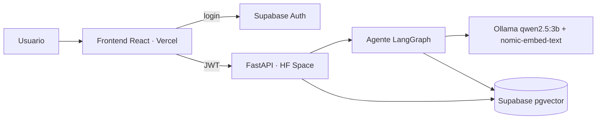
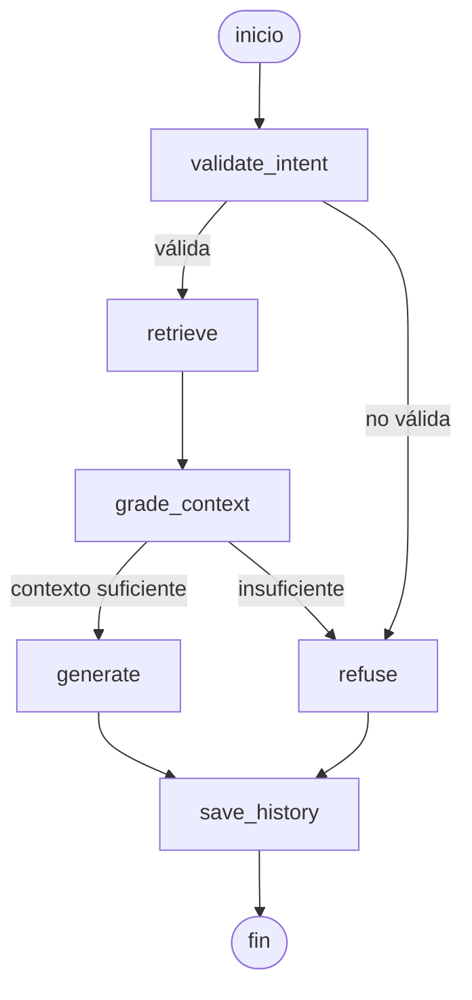

# Arquitectura

## Grafo del agente

## Capas del backend

`controllers` (HTTP, validación de JWT) → `services` (ingesta, embeddings, agente) → `repositories` (pgvector, historial). Ollama corre dentro del mismo contenedor que FastAPI.

**PENDIENTE:** exportar el diagrama a `docs/arquitectura.png` (https://mermaid.live → Download PNG).
