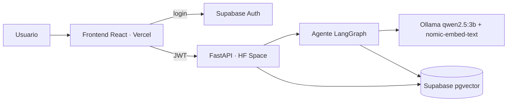
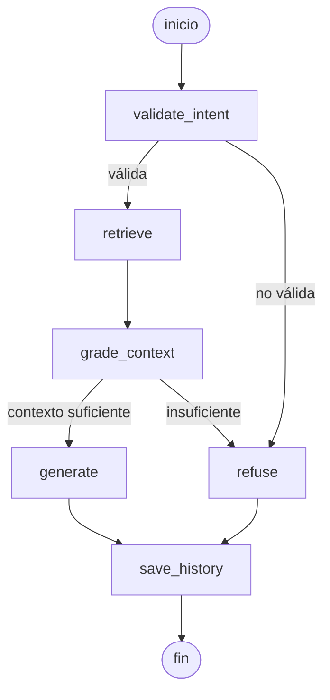

# Documento técnico — Hextech Archive

> Los elementos marcados **PENDIENTE** requieren mediciones, evidencias o URLs que se completan tras el despliegue.

## 1. Nombre del proyecto e integrantes

- Proyecto: **Hextech Archive** — agente RAG sobre el lore de Runeterra y los campeones de League of Legends.
- Integrantes: **PENDIENTE:** nombres completos. Reparto previsto: Persona A (agente LangGraph, ingesta, pgvector, modelo local); Persona B (frontend, auth, API de historial y documentos, Vercel); ambos (corpus, documento, diapositivas, sustentación).

## 2. Tema y problema

El lore de Runeterra está disperso en cientos de fichas de campeones, relatos y wikis. Un modelo de lenguaje general inventa con facilidad datos de lore (alucinación). Hextech Archive permite consultar ese conocimiento en lenguaje natural con una garantía: el agente responde **solo** con fragmentos recuperados de una base vectorial, cita las fuentes y, si no encuentra contexto suficiente, rechaza explícitamente con el mensaje fijo "No tengo suficiente información en mi base de conocimiento para responder esa pregunta." El usuario puede ampliar la base subiendo sus propios documentos.

## 3. Arquitectura

El frontend (Vercel) autentica con Supabase Auth y envía el JWT a la API FastAPI desplegada en un Hugging Face Space (Docker, CPU), que contiene también Ollama. FastAPI y el agente consultan Postgres/pgvector en Supabase. **PENDIENTE:** insertar `docs/arquitectura.png`.

## 4. Tecnologías

| Capa | Tecnología | Motivo |
|---|---|---|
| Frontend | React + Vite + Tailwind | SPA rápida, estética hextech personalizable |
| Backend | FastAPI (Python 3.11) | Async, streaming SSE, validación con Pydantic |
| Agente | LangChain + LangGraph | Grafo explícito con aristas condicionales, escrito en código |
| LLM | Ollama `qwen2.5:3b` | Modelo local, buen español, corre en CPU |
| Embeddings | Ollama `nomic-embed-text` (768 dim) | Local y ligero |
| Auth | Supabase Auth | JWT, registro/login sin construir un servicio propio |
| Vectores | PostgreSQL + pgvector (Supabase) | Una sola base para datos y vectores, con RLS |
| Despliegue | Hugging Face Spaces (Docker) + Vercel | Gratuito, URLs públicas |

## 5. Backend

Arquitectura por capas: `controllers` (endpoints HTTP) → `services` (ingesta, embeddings, agente) → `repositories` (pgvector e historial). Módulos: `security` (validación JWT), `loaders` (extracción de texto y fragmentación), `agents` (grafo LangGraph), `config` (variables de entorno con pydantic-settings).

Endpoints (todos exigen `Authorization: Bearer <JWT>` salvo `/health`): `POST /chat` (streaming SSE), `GET /conversations`, `GET /conversations/{id}`, `POST /documents` (multipart), `GET /documents`, `DELETE /documents/{id}`, `GET /me`, `GET /health`.

Datos: `documents(id, user_id, name, type, status, error, created_at)`, `chunks(id, document_id, content, metadata, embedding vector(768))`, `conversations`, `messages(…, sources, refused)`. El corpus base tiene `user_id` nulo y es de solo lectura.

Pruebas: tests con dobles (LLM/embeddings falsos) para el grafo (ruta de respuesta y de rechazo), validación de JWT (válido, expirado, ausente), carga de documentos y loaders, más un test de integración con Postgres real (`TEST_DATABASE_URL`). **PENDIENTE:** resultado de `python -m pytest` (nº de tests).

## 6. Frontend

React + Vite + Tailwind. Pantallas: Login/Registro, Chat (respuestas con fuentes citadas), Biblioteca de documentos (estados procesando/listo/error), Historial. Rutas protegidas, validación de formularios y mensajes claros cuando el agente rechaza. Registro, login y cierre de sesión con Supabase Auth. Estética "Runeterra / hextech": azul abismo `#010A13`, dorado `#C8AA6E`, azul hextech `#0AC8B9`; tipografías Cinzel, Cormorant Garamond y JetBrains Mono; responsive y accesible (contraste, foco visible, `prefers-reduced-motion`).

## 7. Agente y flujo LangGraph

Estado: `question`, `intent_ok`, `chunks[]` (contenido, score, fuente), `context_ok`, `answer`, `sources[]`, `refused`.

Nodos:
1. `validate_intent`: descarta mensajes vacíos, saludos y preguntas claramente ajenas a LoL/Runeterra.
2. `retrieve`: búsqueda por similitud en pgvector (top-k), filtrada por corpus compartido más los documentos del usuario.
3. `grade_context`: umbral mínimo de similitud sobre los chunks y verificación del modelo ("¿este contexto permite responder? sí/no").
4. `generate`: responde solo con el contexto, en español, citando fuentes; el prompt prohíbe conocimiento externo.
5. `refuse`: mensaje fijo de rechazo y sugerencia de subir documentos relacionados.
6. `save_history`: persiste pregunta, respuesta, fuentes y bandera `refused`.

Aristas condicionales: tras `validate_intent` (a `retrieve` o `refuse`) y tras `grade_context` (a `generate` o `refuse`). Todas las rutas terminan en `save_history`. La respuesta se envía por SSE (eventos `step`, `token`, `final`).

## 8. Modelo local y base vectorial

**Modelo local.** Se eligió `qwen2.5:3b` por su buen rendimiento en español con un tamaño que cabe y corre en CPU (el hardware de desarrollo no tiene GPU dedicada y el Space free dispone de CPU y 16 GB de RAM). Ollama corre dentro del mismo contenedor que la API; los modelos (`qwen2.5:3b`, `nomic-embed-text`) se descargan durante el build de la imagen y `start.sh` arranca Ollama, calienta el modelo y lanza uvicorn en el puerto 7860. Alternativa documentada: `llama3.2:3b`.

Limitaciones en CPU: la inferencia es lenta (riesgo estimado de 20-40 s por respuesta en CPU compartida). Mitigaciones: streaming SSE, `num_ctx` reducido, `top_k` pequeño, `OLLAMA_KEEP_ALIVE=24h`, `OLLAMA_NUM_PARALLEL=1` y calentamiento del modelo al arrancar. **PENDIENTE:** tokens/s medidos en local y en el Space; latencia de la primera respuesta y de las siguientes.

**Base vectorial.** PostgreSQL con la extensión pgvector en Supabase. Columna `embedding vector(768)` (dimensión de `nomic-embed-text`), índice **HNSW** con operador de **distancia coseno** (`vector_cosine_ops`), más índice por `document_id`. Los chunks se borran en cascada con su documento.

## 9. Carga de documentos

Formatos: PDF, TXT, MD, CSV, DOCX, JSON (multimedia queda como trabajo futuro). Los 6 pasos:
1. Recibir el archivo (`POST /documents`, multipart), validando tipo y tamaño máximo (`MAX_UPLOAD_MB`).
2. Extraer el texto según el formato (`loaders/extract`).
3. Dividir en fragmentos con solape (`loaders/chunking`).
4. Generar embeddings con `nomic-embed-text`.
5. Guardar los chunks en pgvector asociados al `document_id` y al usuario.
6. Confirmar al usuario: el documento pasa de `processing` a `ready` (o `error` con el motivo); el endpoint responde 202 y el procesamiento es posterior.

Corpus base (`scripts/seed_corpus`): Data Dragon en español (lore, habilidades, roles de campeones). Se reservan campeones (p. ej. Briar) fuera del corpus para la demo de carga en vivo.

## 10. Estrategias anti-alucinación

Se implementan cuatro (el PDF pide al menos dos):
1. **Umbral de similitud** (`SIMILARITY_THRESHOLD`, valor inicial 0.55): chunks por debajo no cuentan como contexto. **PENDIENTE:** valor calibrado y tabla de evaluación (~20 preguntas válidas y fuera de tema: pregunta, mejor score, esperado, resultado, tasa de rechazo correcto).
2. **Nodo `grade_context`**: además del umbral, el modelo verifica si el contexto permite responder; si no, se rechaza.
3. **Prompt restrictivo**: solo el contexto recuperado, sin conocimiento externo, en español.
4. **Rechazo literal y fuentes visibles**: mensaje fijo de rechazo y fragmentos/fuentes citados en cada respuesta, de modo que el usuario puede verificarlos.

## 11. Seguridad

- **Autenticación:** Supabase Auth; el frontend obtiene el JWT.
- **Validación del JWT** en el backend: firma (secreto o JWKS), expiración y audiencia; si no hay clave configurada, la validación falla cerrada. Todos los endpoints salvo `/health` la exigen.
- **RLS** por `user_id` en todas las tablas; el corpus base (`user_id` nulo) es de solo lectura para todos.
- **Filtrado por `user_id`** en consultas del backend: cada usuario solo ve sus documentos y conversaciones, y la recuperación combina corpus compartido más sus propios documentos.
- **Límites de carga:** tipos permitidos y tamaño máximo (`MAX_UPLOAD_MB`).
- **CORS** restringido a `CORS_ORIGINS` (URL de Vercel y localhost).
- Los secretos (`DATABASE_URL`, `SUPABASE_JWT_SECRET`) viven en Secrets del Space y en `.env` (ignorado por git).

## 12. Despliegue

- Backend: Hugging Face Space (SDK Docker, CPU basic). Variables y secrets como en el README raíz. Imagen con Ollama y modelos incluidos; puerto 7860; usuario 1000.
- Frontend: Vercel, Root Directory `frontend`, variables `VITE_API_URL`, `VITE_SUPABASE_URL`, `VITE_SUPABASE_ANON_KEY`.
- URLs públicas: **PENDIENTE:** URL del frontend (Vercel) y del backend (`https://<usuario>-hextech-archive.hf.space`); enlace al repositorio GitHub.
- **PENDIENTE:** tiempo de build, latencias observadas y problemas encontrados durante el despliegue.

## 13. Evidencias

**PENDIENTE:** capturas en `docs/capturas/`: login, chat con fuentes, pregunta rechazada, biblioteca de documentos (subida y estado `ready`), historial, `/health` del Space, tabla de evaluación del umbral.

## 14. Problemas y conclusiones

Problemas esperados/riesgos de diseño: latencia del modelo 3B en CPU (mitigada con streaming, contexto reducido y calentamiento); calibración del umbral de similitud, que equilibra rechazos falsos y alucinaciones; arranque en frío del Space. **PENDIENTE:** problemas reales encontrados y cómo se resolvieron.

Conclusiones: un grafo explícito con validación de intención y evaluación del contexto permite que un modelo pequeño y local responda de forma fiable y rechace cuando no sabe; pgvector en Supabase simplifica la infraestructura. Trabajo futuro: ingesta multimedia (JPG/MP4/MP3), roles de administrador, moderación avanzada del contenido subido.

## Atribución de fuentes

- Datos de campeones: **Data Dragon** (Riot Games).
- Textos de la wiki de League of Legends en **Fandom**, licencia CC BY-SA.
- Proyecto educativo sin fines comerciales; no respaldado por Riot Games. League of Legends y Runeterra son marcas de Riot Games, Inc.

**PENDIENTE:** exportar este documento a `docs/documento-tecnico.pdf`.
